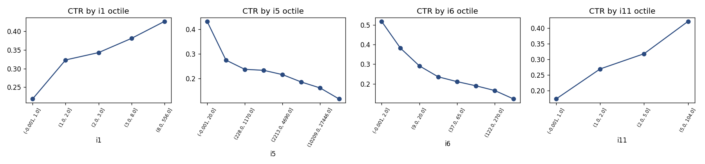

# Ad click prediction on the Criteo dataset — from raw logs to calibrated click probabilities

End-to-end click-through-rate (CTR) pipeline on the public
[Criteo Display Advertising dataset](https://ailab.criteo.com/ressources/)
(13 numeric + 26 hashed categorical features, label = click).

**Business question:** given an ad impression, how likely is a click? In display
advertising this probability drives the bid price, so the model must be both
*discriminative* (AUC) and *calibrated* (log-loss, calibration curve).

```
raw TSV ──> PostgreSQL (COPY, SQL exploration) ──> pandas EDA ──> features ──> models ──> metrics
```

## Results (official 100k-row sample, time-based split: last 20% of rows = test)

| model                                | log-loss | AUC    |
|:-------------------------------------|---------:|-------:|
| constant (train CTR)                 | 0.5459   | 0.500  |
| logistic regression (hashed one-hot) | **0.4656** | **0.766** |
| LightGBM (categorical)               | 0.4793   | 0.756  |

Full tables: [reports/metrics.md](reports/metrics.md) · SQL: [reports/sql_exploration.md](reports/sql_exploration.md) · EDA: [reports/eda.md](reports/eda.md)



## What I learned from the data (SQL + pandas)

- **Missing values are informative.** `i12` is missing in 77% of rows, `i1` in 44%; rows with
  missing `i1` have CTR 0.16 vs 0.43 for `i1 > 10`. Hence explicit `*_missing` indicator features.
- **Numeric features are heavy-tailed counts** (mean ≫ median, e.g. `i5` mean 17 592 vs median 2 213):
  `log1p` before the linear model.
- **Categorical cardinality spans 3 → 43 869 distinct values** in only 100k rows. One-hot encoding
  is impossible at scale, so: hashing trick (2^18 buckets) for logistic regression, rare-value
  grouping (`< 10` occurrences → `RARE`) for LightGBM. Both are fitted on train only.
- **Rows are chronological**, so the split is by time, not random — the test set is "the future".
  CTR drifts upward in the last decile (0.245 vs ~0.225), a realistic production effect.
- **Baseline first.** The constant predictor gives the log-loss floor (0.546); any model must beat it.

## Repository layout

```
src/criteo_ctr/
  config.py      column names, paths, split settings
  download.py    fetch + extract the official sample
  io.py          typed loader for the raw TSV
  db.py          PostgreSQL schema, COPY loader, runs sql/explore.sql -> Markdown
  sql/           schema.sql, explore.sql (CTR by feature, missing rates, cardinality, drift)
  eda.py         pandas/Matplotlib EDA -> reports/eda.md + figures
  features.py    log1p + missing flags, hashing trick, rare-value grouping, time split
  train.py       constant baseline, logistic regression, LightGBM; log-loss, AUC, calibration
tests/           pytest for the feature pipeline
reports/         generated tables and figures
```

## Run it

```bash
pip install -r requirements.txt
make data        # download 100k-row sample (~9 MB)
make db-load     # docker compose up + schema + COPY into PostgreSQL
make sql         # exploration queries -> reports/sql_exploration.md
make eda         # figures + reports/eda.md
make train       # models -> reports/metrics.md + calibration plot
make test
```

Requires Python ≥ 3.10 and Docker (for PostgreSQL).

## Next steps

- [ ] Tune LightGBM (early stopping on a time-based validation set, `num_leaves`, `min_child_samples`):
      on 100k rows it currently underperforms the linear model — why?
- [ ] Regularisation sweep for logistic regression (`C`, L1 vs L2), compare hash sizes 2^16–2^22.
- [ ] Feature crosses (e.g. `c6 × c9`) via the hasher — the classic trick behind factorization machines.
- [ ] Scale up: the full dataset (45M rows, 4.5 GB) with chunked loading / out-of-core SGD.
- [ ] Fairness angle: check whether calibration differs across segments of a categorical feature.
